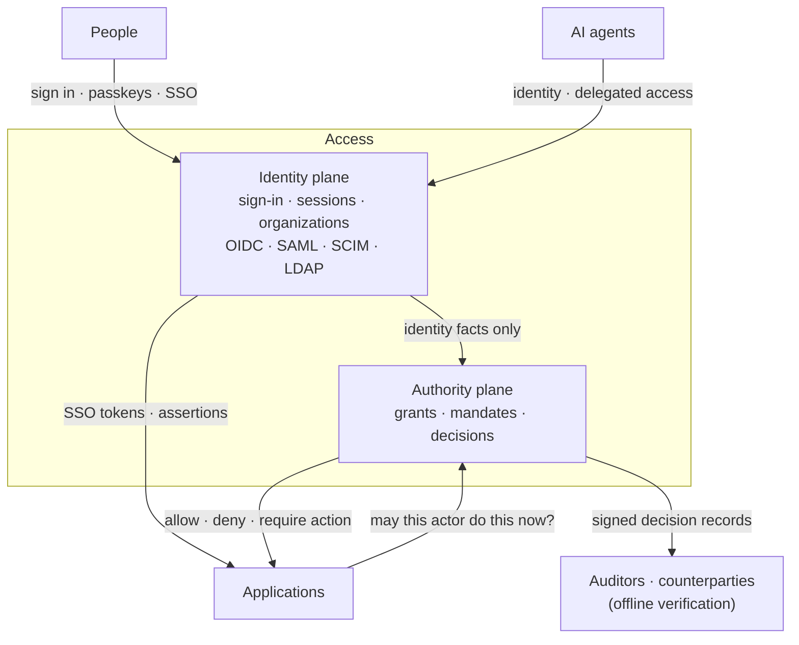

# Access

**Open-source identity and authority for people, organizations and AI agents.**

Access is a complete identity provider with an authority layer on top. It signs people in, federates with the systems they already use, and decides — for every request — whether *this actor, on this authority, may do this exact thing now*. Every decision leaves a record that third parties can verify without asking Access.

[](LICENSE)


---

## Why Access

Most identity systems answer *who are you?* and stop there. Authorization is left to roles, scopes and application code — and breaks down as soon as AI agents act on someone's behalf.

Access treats both questions as first-class:

- **Identity** — a full IdP: sign-in, passkeys, MFA, sessions, organizations, SSO, provisioning and federation.
- **Authority** — explicit grants and delegations that only ever narrow, checked on every action, revoked immediately, and recorded with proof.

## Features

**Identity provider**
- OpenID Connect and OAuth 2.1 (PKCE, PAR, DPoP, token exchange, CIBA, FAPI 2)
- SAML 2.0, SCIM 2.0, LDAP, Kerberos, RADIUS, WS-Federation, OpenID Federation
- Passkeys (WebAuthn), TOTP, passwordless email, step-up authentication
- B2B organizations: invitations, verified domains, self-service SSO and SCIM setup
- Embeddable UI components and hosted pages, theming and localization

**Authority**
- Grants, mandates and delegation chains that can only narrow
- Allow / deny / require-action decisions with explanations
- Approvals with exact intent binding; no impersonation, ever
- Immediate revocation with cascade
- Signed, independently verifiable decision records and an offline verifier

**Built for AI agents**
- Agent identities with accountable human owners
- MCP authorization server, token vault and scoped release of upstream credentials
- Human approval flows for agent actions

**Operations**
- Self-hosted or Suiss-hosted — same code, no paid-only features
- PostgreSQL storage, hardware-backed signing keys (HSM over PKCS#11)
- Audit logs, webhooks, SIEM streams, multi-region cells

## How it works



Signing in never grants authority by itself: the identity plane passes facts, and the authority plane decides.

## Getting started

Access is pre-alpha: the project foundation (workspace, CI gates, local environment) is in place and the Kernel is next. To build and test:

```sh
git clone https://github.com/e-suiss/access.git
cd access
just dev     # PostgreSQL, NATS, SoftHSM (PKCS#11), Mailpit, observability
just check   # formatting, lints, repository rules, dependency policy
just test    # the same tests CI runs on every change
```

You need Rust (the pinned toolchain installs itself from `rust-toolchain.toml`), [`just`](https://github.com/casey/just) and Docker.

SDKs are planned for TypeScript/Node, Python, Go, Java, .NET, Elixir, PHP and Ruby, plus iOS, Android, React Native and Flutter.

## Run Access locally

To build a product against a real Access, start the published image with Docker Compose. Nothing runs in a "development mode": the same binaries and checks as production, with SoftHSM as the PKCS#11 token and a local certificate authority for TLS.

```sh
docker compose -f deploy/compose/access.yaml up -d
docker compose -f deploy/compose/access.yaml logs bootstrap   # tenant, realm and client ids
```

This starts PostgreSQL (TLS only), the authority and identity signers, applies the migrations (`access-server migrate`) and runs `access-server bootstrap`, which creates the platform tenant with its realm and a sample `acme` tenant. Access listens on `https://access-server:8443` inside the `access-local` network and on `127.0.0.1:8443` on your machine.

The bootstrap prints, and keeps in the `bootstrap` volume as `bootstrap.json`:

- `realms[]`: the `tnt_…` tenant id, realm id, issuer, governing domain and `discovery` URL (`/.well-known/suiss-configuration`) of each realm
- `clients[]`: each registered platform product client and the `aud` its client assertions use
- `root`: the Party that founded the realms

To register a product's platform client, put its public keys as JWK files in a directory and run the bootstrap with the product plan:

```sh
ACCESS_PRODUCT_KEYS=./my-keys \
ACCESS_BOOTSTRAP_PLAN=/etc/access/local/bootstrap-work.toml \
  docker compose -f deploy/compose/access.yaml up -d
```

`work-client.jwk` (P-256) verifies the product's client assertions and `work-service.jwk` (Ed25519 or P-256) is its service key for pairing. Running the bootstrap again changes nothing and prints the same ids.

Your own containers join the `access-local` network. The `certs` volume holds the local CA (`ca.crt`) and a PEP client certificate (`pep.crt`, `pep.key`) for the `/access/v1` API. Access pushes events only to public addresses on port 443, so on a local network read them from a poll stream (`POST /access/v1/platform/streams`). Pin the image with `ACCESS_IMAGE=ghcr.io/e-suiss/access:main-<sha>-local`.

## Tech stack

Rust (single backend), PostgreSQL, NATS, HSM-backed keys over PKCS#11, React for UI components.

## Related projects

- **[Relay](https://github.com/e-suiss/relay)** — notification, messaging and event orchestration. Access and Relay are parts of one system and are always deployed together: Access sends its messages through Relay, and Relay uses Access for sign-in, credentials and approvals.

## Contributing

Contributions are welcome. Read [CONTRIBUTING.md](CONTRIBUTING.md) before opening a pull request, and report vulnerabilities privately as described in [SECURITY.md](SECURITY.md).

## License

Access is open source under the [Apache License 2.0](LICENSE).
