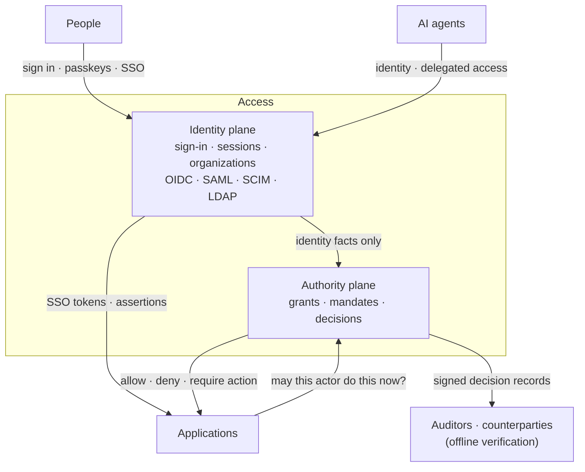

# Access

**Open-source identity and authority for people, organizations and AI agents.**

Access is a complete identity provider with an authority layer on top. It signs people in, federates with the systems they already use, and decides — for every request — whether *this actor, on this authority, may do this exact thing now*. Every decision leaves a record that third parties can verify without asking Access.

[](LICENSE)


---

## Why Access

Most identity systems answer *who are you?* and stop there. Authorization is left to roles, scopes and application code — and breaks down as soon as AI agents act on someone's behalf.

Access treats both questions as first-class:

- **Identity** — a full IdP: sign-in, passkeys, MFA, sessions, organizations, SSO, provisioning and federation.
- **Authority** — explicit grants and delegations that only ever narrow, checked on every action, revoked immediately, and recorded with proof.

## Features

**Identity provider**
- OpenID Connect and OAuth 2.1 (PKCE, PAR, DPoP, token exchange, CIBA, FAPI 2)
- SAML 2.0, SCIM 2.0, LDAP, Kerberos, RADIUS, WS-Federation, OpenID Federation
- Passkeys (WebAuthn), TOTP, passwordless email, step-up authentication
- B2B organizations: invitations, verified domains, self-service SSO and SCIM setup
- Embeddable UI components and hosted pages, theming and localization

**Authority**
- Grants, mandates and delegation chains that can only narrow
- Allow / deny / require-action decisions with explanations
- Approvals with exact intent binding; no impersonation, ever
- Immediate revocation with cascade
- Signed, independently verifiable decision records and an offline verifier
- An authority hub — who acts for you, what you shared, what you hold, every use and every change — from an open experience backend that holds no authority itself

**Built for AI agents**
- Agent identities with accountable human owners
- MCP authorization server, token vault and scoped release of upstream credentials
- Human approval flows for agent actions

**Operations**
- Self-hosted or Suiss-hosted — same code, no paid-only features
- PostgreSQL storage, hardware-backed signing keys (HSM over PKCS#11)
- Audit logs, webhooks, SIEM streams, multi-region cells

## How it works



Signing in never grants authority by itself: the identity plane passes facts, and the authority plane decides.

## Getting started

Access is pre-alpha: the project foundation (workspace, CI gates, local environment) is in place and the Kernel is next. To build and test:

```sh
git clone https://github.com/e-suiss/access.git
cd access
just dev     # PostgreSQL, NATS, SoftHSM (PKCS#11), Mailpit, observability
just check   # formatting, lints, repository rules, dependency policy
just test    # the same tests CI runs on every change
```

You need Rust (the pinned toolchain installs itself from `rust-toolchain.toml`), [`just`](https://github.com/casey/just) and Docker.

SDKs are planned for TypeScript/Node, Python, Go, Java, .NET, Elixir, PHP and Ruby, plus iOS, Android, React Native and Flutter.

## Run Access locally

To build a product against a real Access, start the published image with Docker Compose. Nothing runs in a "development mode": the same binaries and checks as production, with SoftHSM as the PKCS#11 token and a local certificate authority for TLS.

```sh
ACCESS_LOCAL_TEST_PASSWORD='choose one' docker compose -f deploy/compose/access.yaml up -d
docker compose -f deploy/compose/access.yaml logs bootstrap   # tenant, realm and client ids
```

This starts PostgreSQL (TLS only), the authority and identity signers, applies the migrations (`access-server migrate`) and runs `access-server bootstrap`, which creates the platform tenant with its realm, a sample `acme` tenant and a test user in it. Access listens on `https://access-server:8443` inside the `access-local` network and on `127.0.0.1:8443` on your machine. The management API (`/admin/v1/realms/{slug}/…`, `/admin/v1/platform/…`, contract in `sdks/openapi/admin-v1.json`) has its own listener on port 9443 (`127.0.0.1:9443`, origin `https://access-server.local:9443`: map `access-server.local` to `127.0.0.1` to sign in to the console); `/livez`, `/readyz`, `/healthz` and `/metrics` are on the internal port 9090 only. `ACCESS_LOCAL_TEST_PASSWORD` is the test user's password; there is no default, you choose it.

The bootstrap prints, and keeps in the `bootstrap` volume as `bootstrap.json`:

- `realms[]`: the `tnt_…` tenant id, realm id, issuer, governing domain and `discovery` URL (`/.well-known/suiss-configuration`) of each realm
- `clients[]`: each registered platform product client, the `aud` its client assertions use and its registered return addresses (`redirect_uris`, from the plan's `[[products]] redirect_uris`; an older plan's single `redirect_uri` is a list of one), which the Approval Surface of every realm matches exactly
- `root`: the Party that founded the realms
- `sample`: what a real `POST /access/v1/eligibility:check` names to be answered `eligible: true`. The `acme` realm publishes a `work` catalog with the action `approve`, and its root grants that action over the whole `work` namespace to a sample subject. `sample.subject` is the check's `subject`; `domain`, `action`, `resource` and `basis` go into its `set` (`resource` in `intent.resources`, with an `intent.validity` of at most 24 hours around now, and `"capacity": "own"`)
- `test_user`: the `acme` user `test@acme.example` (identifier, `usr_…` subject) with the password you chose, a software passkey (`passkey`, its credential id; the key is `access/bootstrap/test-user-passkey` in the server's token, registered through the realm's own WebAuthn ceremony as a device-bound, user-verified credential) and the public client (`client_id`, `redirect_uri`) a sign-in uses: authorization code with PKCE and DPoP, no client secret. The user also has a device Instance (`instance`) that binds them to a Party (`party`), registered with a device key kept in the bootstrap token the way `POST /v1/me/instances` does; `POST /access/v1/tenants/{tenant}/subjects:resolve` resolves the user's pairwise `sub` to that Party, and `GET /access/v1/parties/{party}` answers its status
- `test_user.totp`: the user's authenticator app, enrolled through the realm's own TOTP enrollment when the plan's `[test_user]` names a `totp_seed_file` (both shipped plans do). The seed is random, written in base32 to that file in the bootstrap volume (`/var/lib/access/bootstrap/test-user-totp`, owner-only) and never printed; the summary gives the file and the code's parameters (`SHA1`, 6 digits, 30-second steps). With the password, a code from it answers the hosted login's `second_factor` step (`{"method": "totp", "fields": {"totp_code": "…"}}`), which a browser test can do without the passkey's token
- `test_user.allowed`: what an Exercise the user is allowed to make names. The `work` catalog also publishes `commit` (parameters `ledger`, a text, and `declaration`, a digest), granted to the user's Party under an approval requirement: the first `commit` is answered `REQUIRE_ACTION`, and one `approve` contribution by the same user on the hosted Approval Surface turns it into an `ALLOW` with a signed receipt. `action` and `params` go into the intent; `resource` names the resources the Grant covers, a `namespace` (`work.ledger`) and the `path_prefix` (`led_`) their first path element starts with, so an entry of `intent.resources` is `{"namespace": "work.ledger", "path": ["led_main"]}`; `basis` is the user's holding, and `contribution.basis` is the holding the approval is contributed under. The plan's `[sample]` section sets both with `resource_namespace` and `resource_path_prefix`. With `step_up = "aal2"` in `[sample]` (the Work plan has it, the default plan does not), the Grant also asks for the user's fresh AAL2 authentication bound to their device Instance: the first `commit` then leaves two terms unmet, the approval and an `authentication` Claim (a product shows this as its step-up), and the one passkey assertion on the Approval Surface meets both; the summary says `step_up = "aal2"`, the approval's redirect carries the Claim as `claim`, and the product passes it as `{"claim_ref": …}` beside `{"contribution": …}` when it commits again
- `compromise`: the Party (`issuer`) whose unsigned `party_compromise` Claims the `acme` realm accepts over a PEP certificate, and the realm's `domain`

### Sign in without a browser

`access-local-client` runs the real sign-in against the running Access and prints the tokens: the JSON steps of the hosted login (identifier, then the password or a passkey assertion), then `/authorize` and `/token` with PKCE and a DPoP proof. It verifies TLS against the local CA and refuses plain `http://`.

```sh
docker compose -f deploy/compose/access.yaml run --rm local-client login \
  --issuer https://access-server:8443/realms/acme --ca /var/lib/access/certs/ca.crt \
  --client-id <test_user.client_id> --redirect-uri http://127.0.0.1/cb \
  --identifier test@acme.example --password-env BOOTSTRAP_TEST_PASSWORD
```

With `--passkey access/bootstrap/test-user-passkey` in place of `--password-env`, the client signs in with the test user's software passkey instead (AAL2, phishing-resistant). The key stays in the server's token; the client reaches it through PKCS#11 with `--hsm-module /usr/lib/softhsm/libsofthsm2.so --hsm-token access-server --hsm-pin-file /var/lib/access/secrets/hsm-access-server`, which the `local-client` service has in reach.

Add `--device-key access/bootstrap/test-user-device` (with the same `--hsm-*` flags) to sign in as a known device: after the sign-in the client proves the test user's device key over a challenge (`POST /v1/me/instances/challenges`, then `POST /v1/me/instances/bindings`) and the new session is bound to the device's existing Instance, the one `test_user.instance` names; no new Instance is opened. The output then carries `instance`, and an `auth_context` issued for that session names it. This needs an AAL2 session, so pair it with `--passkey` (alone, or as the second factor beside `--password-env`).

Add `--resource <your platform client_id>` to get an access token addressed to your product: its `aud` is your `client_id`, the same value your events carry, and it stays bound to the client's DPoP key (`cnf.jkt`). Only a registered platform product client can be named; anything else is `invalid_target`. From a checkout, `cargo run -p access-local-client -- login … --connect 127.0.0.1:8443` reaches the published port with the issuer unchanged (the CA is `ca.crt` from the `certs` volume).

### Approve an Exercise without a browser

`access-local-client approve` runs one allowed Exercise end to end, the way a product and its user would: it signs the test user in with the passkey; as the product's PEP (`--cert`, `--key`) it commits the intent at `POST /access/v1/evaluation` with an AIS the user's device key signs and gets `REQUIRE_ACTION`; it pushes the typed authority request with the contribution the device pre-signed to `POST /v1/approve/requests`, opens the flow at `POST /v1/approve/flows`, checks that the render the decision point kept is the render of the intent it sent, answers the challenge (H(AAS)) with the passkey at `POST /v1/approve/flows/{flow}`, commits the intent again with the contribution as its proof (and the approver's `authentication` Claim as `claim_ref` when the first answer also asked for a step-up, see `step_up` above) and verifies the receipt the `ALLOW` carries against the domain's published metadata. It prints `exercise`, `contribution`, `claim`, `step_up`, `render_digest` and the verified `receipt`.

Approval return addresses come from the product's platform registration: `--redirect-uri` (the `redirect_uri` of `GET /v1/approve`) must be exactly a redirect URI an active client registered, either in the realm the approval runs in or, for a platform product such as Work, in the platform realm (the `redirect_uri` of its `[[products]]` entry). A product is registered once, in the platform realm; tenant realms need no registration of their own, and anything else is `invalid-redirect-uri` (RFC 6749 §3.1.2 exact match). The compose example above uses the test user's own client in `acme`.

```sh
# the intent, from test_user.allowed; the resource path starts with allowed.resource.path_prefix
# and the parameters are the schema's
intent='{"action": <allowed.action>, "resources": [{"namespace": <allowed.resource.namespace>, "path": ["<allowed.resource.path_prefix>main"]}],
  "params": {"ledger": {"eq": "main"}, "declaration": {"eq": {"bytes": "<32 bytes, base64url>"}}},
  "validity": {"from": <now - 60 s, ms>, "until": <now + 10 min, ms>}}'
docker compose -f deploy/compose/access.yaml run --rm local-client approve \
  --issuer https://access-server:8443/realms/acme --api https://access-server:8443 \
  --ca /var/lib/access/certs/ca.crt --cert /var/lib/access/certs/pep.crt --key /var/lib/access/certs/pep.key \
  --redirect-uri http://127.0.0.1/cb --identifier test@acme.example \
  --hsm-module /usr/lib/softhsm/libsofthsm2.so --hsm-token access-server \
  --hsm-pin-file /var/lib/access/secrets/hsm-access-server \
  --device-key access/bootstrap/test-user-device --passkey access/bootstrap/test-user-passkey \
  --domain <allowed.domain> --party <test_user.party> --instance <test_user.instance> \
  --grant <allowed.basis.holding.grant> --grant-since <allowed.basis.holding.since> \
  --contribute-grant <allowed.contribution.basis.holding.grant> --contribute-since <allowed.contribution.basis.holding.since> \
  --intent-json "$intent"
```

`--intent <file>` reads the intent from a file instead. With `--request <file>`, a typed authority request your product already built for its own `REQUIRE_ACTION` (`require_action` naming the same intent), the client only pushes and approves it and prints the contribution; the product then commits again with that contribution as its proof. A request for an intent nothing waits for is `approval-request-changed`; a key that is not the user's passkey is refused at sign-in.

### What the Approval Surface shows

The hosted page at `/v1/approve` shows the request exactly as the decision point rendered it from the accepted Action Schema, so the digest the approver signs is the digest of what they saw. Beside it: the capacity the approver approves in, what is still needed in words anyone can check ("1 more · not the requester · a different person"; two approvals by the same person count as one), what approving does and doesn't do, the concrete act ("Confirm with your passkey"), and the requester's note, shown second. A request whose render can't be shown faithfully, whose attached body doesn't match the digest in the intent, or that the viewer isn't eligible to approve has no button. `GET /consent` sends the browser to the same page; consent is never a form post.

Access doesn't own your approval UI. Any surface that passes the WYSIWYS vectors in `conformance/vectors/approval/1/` can collect approvals: Access keeps the approval rules, the digest and the required assurance, the surface shows the render faithfully and takes the user's act, your coordinator says why, and your product carries out the effect. A notification or an agent's summary is only an invitation, never the approval.

### Produce events on purpose

Your product's end-to-end tests can make Access emit the events it subscribes to:

```sh
# api_client.updated and api_client.disabled: change or retire the platform client of a product
docker compose -f deploy/compose/access.yaml run --rm bootstrap \
  access-server client-update /etc/access/local/bootstrap-work.toml work "Suiss Work (renamed)"
docker compose -f deploy/compose/access.yaml run --rm bootstrap \
  access-server client-retire /etc/access/local/bootstrap-work.toml work

# party.compromised: a compromise declaration over the PEP certificate for a Party of acme
docker compose -f deploy/compose/access.yaml run --rm local-client compromise \
  --api https://access-server:8443 --ca /var/lib/access/certs/ca.crt \
  --cert /var/lib/access/certs/pep.crt --key /var/lib/access/certs/pep.key \
  --domain <compromise.domain> --issuer-party <compromise.issuer> --party <sample.subject>

# a stream's status (enabled, paused, disabled), as a platform client, with its own client key
docker compose -f deploy/compose/access.yaml run --rm local-client stream-status \
  --api https://access-server:8443 --issuer https://access-server:8443/realms/platform \
  --ca /var/lib/access/certs/ca.crt --client-id <clients[].client_id> \
  --client-key /etc/access/products/work-client.private.jwk --stream <stream id> --status paused
```

A retired client is retired for good; the next `bootstrap` run registers a new one. The stream status route is `GET`/`POST /access/v1/platform/streams/{id}/status`, with the same rules as a stream's own `/ssf/status`; `disabled` ends the stream. Events that happened before a stream was opened are not delivered to it.

### Call another product

A platform product that needs to call another platform product (Work calling Relay, say) asks the platform realm's token endpoint for a service token: `grant_type=client_credentials`, its RFC 7523 client assertion, a DPoP proof, and `resource=<the other product's client_id>` (RFC 8707), with no `authorization_details`. The answer is an `at+jwt` whose `aud` is the other product's `client_id`, `client_id` the caller, `access_tenant` the caller's `tnt_…` tenant, `sub` the pairwise id the other product reads of the caller's service Party (the same value `subjects:resolve` gives it for that Party), `cnf.jkt` the proof key, valid for at most five minutes. It says who is calling and nothing more: it carries no `authorization_details`, no scope and no authority. The product it is for verifies it against the realm's JWKS, checks `aud`, `cnf` and `exp`, or asks `/introspect` with its own client assertion. The caller must have paired with the platform realm first, so it holds a service Party there; naming itself, a client that is not a platform product, or anything else is `invalid_target`. A request with `authorization_details` is the authority path, unchanged.

```sh
docker compose -f deploy/compose/access.yaml run --rm local-client service-token \
  --issuer https://access-server:8443/realms/platform --ca /var/lib/access/certs/ca.crt \
  --client-id <clients[].client_id of work> --client-key /etc/access/products/work-client.private.jwk \
  --resource <clients[].client_id of relay>
```

The client signs the assertion and the DPoP proof with the same product key, so `cnf.jkt` is that key's thumbprint; it prints the token response with `dpop_jkt`.

Signed answers start a while after a domain is created. A new domain's first signing key is published before it may sign (65 minutes in the default schedule), and no flag shortens that. Until then, `application/cose` key lookups answer `503` with `"reason": "signer-no-key"`, and decisions carry no signed receipt. The `application/json` form of a key lookup works from the start. A `503` from `/access/v1` always carries a stable `reason`, and a `400` names the part of the body it refused in `errors[]` (`pointer`, `code`).

To register a product's platform client, put its public keys as JWK files in a directory and run the bootstrap with the product plan:

```sh
ACCESS_LOCAL_TEST_PASSWORD='choose one' \
ACCESS_PRODUCT_KEYS=./my-keys \
ACCESS_BOOTSTRAP_PLAN=/etc/access/local/bootstrap-work.toml \
  docker compose -f deploy/compose/access.yaml up -d
```

`work-client.jwk` (P-256) verifies the product's client assertions and `work-service.jwk` (Ed25519 or P-256) is its service key for pairing. Running the bootstrap again changes nothing and prints the same ids.

Your own containers join the `access-local` network. The `certs` volume holds the local CA (`ca.crt`) and a PEP client certificate (`pep.crt`, `pep.key`) for the `/access/v1` API. Pin the image with `ACCESS_IMAGE=ghcr.io/e-suiss/access:main-<sha>-local`.

### Keep your PEP key in your own token

If your product's PEP key must never leave its own PKCS#11 token, put a certificate signing request in the product keys directory instead of using `pep.key`:

```sh
# the key stays in the token; only the CSR is handed over
openssl req -new -provider pkcs11 -provider default -key "pkcs11:token=work;object=pep" -subj "/CN=work-pep" \
  -out ./my-keys/work-pep.csr
ACCESS_PRODUCT_KEYS=./my-keys docker compose -f deploy/compose/access.yaml up -d
```

For each `<name>.csr` (lowercase letters, digits and hyphens; an EC P-256 key), the provisioning checks the CSR's signature and issues `<name>.crt` from the local CA into the `product-tls` volume, next to `ca.crt`. It has the same profile as `pep.crt`: `CN=<name>`, `clientAuth` only, one year. The certificate takes only the key from the CSR; its subject and extensions are ignored. Running the provisioning again keeps the certificate, and a changed CSR gets a new one (`docker compose -f deploy/compose/access.yaml run --rm init`). Access names the client by the certificate's SHA-256 thumbprint.

### Receive pushed events on the local network

Access pushes events (SSF push, webhooks) only to public addresses on port 443, unless the operator declares the exact endpoint URL. The declaration is an ordinary server setting, the same in every deployment and empty by default; TLS to a declared endpoint is always verified, and redirects are not followed. To push to a product on the `access-local` network:

```sh
ACCESS_LOCAL_TEST_PASSWORD='choose one' \
ACCESS_LOCAL_PRODUCT_HOSTS=work-server \
ACCESS_DELIVERY_TARGETS='[{url="https://work-server:8443/v1/inbound/events", ca_file="/var/lib/access/certs/ca.crt"}]' \
ACCESS_PRODUCT_KEYS=./my-keys \
ACCESS_BOOTSTRAP_PLAN=/etc/access/local/bootstrap-work.toml \
  docker compose -f deploy/compose/access.yaml up -d
```

- `ACCESS_LOCAL_PRODUCT_HOSTS` (space separated) makes the provisioning issue `<host>.crt` and `<host>.key` (server certificate, `DNS:<host>`) from the local CA into the `product-tls` volume, next to `ca.crt`. Keys are readable by uid or group 65532: mount the volume read-only in your product and run it as that user or with `group_add: ["65532"]`.
- `ACCESS_DELIVERY_TARGETS` lists the declared endpoints (`delivery_targets` in the server's TOML). A URL is matched byte for byte: `https`, lowercase host, the port unless 443, the full path. `ca_file`, when given, is the only trust anchor for that endpoint.
- The product's `suiss_event_receiver` (`event_receiver` in the bootstrap plan) and any stream it creates must use exactly a declared URL; anything else on a private address or another port is refused.

## Integrations

Access works beside the security products you already run. Each keeps its own job; Access decides who may act and gives them its decisions, events and signals. None of them can grant anything in Access by itself, and Access does not take over their job.

| Kind | Ready for | What Access gives | What stays in the product |
|---|---|---|---|
| Privileged access (PAM) | Teleport, CyberArk | A just-in-time decision for each privileged connection over AuthZEN; short-lived SSH certificates from the realm's SSH CA | Session brokering, recording, the account vault |
| Secret stores | OpenBao, HashiCorp Vault | The `secret.release` decision; the SDK's `resource::release` hands a secret out only for that Exercise, once | The secret and its versions |
| Identity governance (IGA) | Any product that follows the contract | Who can act and what a removal would end, from Access's searches; a reviewer's decision lands as the reviewer's own `grant.revoke` or `grant.issue` | Campaigns, certification, role mining, SoD analysis |
| SIEM | Splunk, Microsoft Sentinel, Datadog, Elastic | The event and audit stream as OCSF, CEF or LEEF over syslog, HTTP or object storage | Search, correlation, alerts |
| HR systems | Personio, BambooHR, HiBob, Workday, SAP SuccessFactors, Kolay İK, Logo | Starters, leavers and moves as accounts and role selections, once the domain accepts the HR source | The employee record |
| Device management (MDM) | Microsoft Intune, Jamf Pro | Device compliance as the MDM's Claim, which only narrows a decision | Enrollment, compliance, inventory |
| Identity verification | Onfido, Persona | The provider's proofing result as its Claim | Document and face checks |
| Risk, fraud and DLP | Any source that sends a Claim or a CAEP event | A risk level or a data label as its source's Claim, which only narrows a decision | Scoring and classification |

The same list is in the console under Developer ▸ Integrations. The seam schemas and mappings are in [`conformance/seams`](conformance/seams).

## Tech stack

Rust (single backend), PostgreSQL, NATS, HSM-backed keys over PKCS#11, React for UI components.

## Related projects

- **[Relay](https://github.com/e-suiss/relay)** — notification, messaging and event orchestration. Access and Relay are parts of one system and are always deployed together: Access sends its messages through Relay, and Relay uses Access for sign-in, credentials and approvals.

## Contributing

Contributions are welcome. Read [CONTRIBUTING.md](CONTRIBUTING.md) before opening a pull request, and report vulnerabilities privately as described in [SECURITY.md](SECURITY.md).

## License

Access is open source under the [Apache License 2.0](LICENSE).
